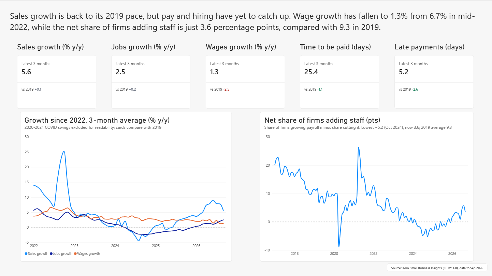
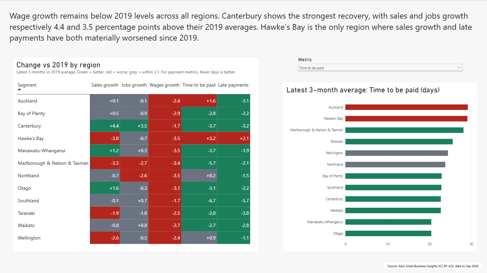
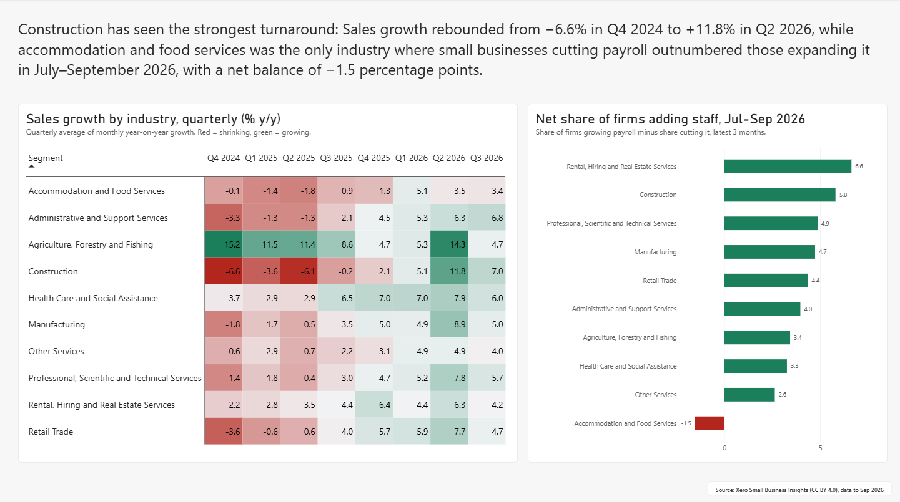
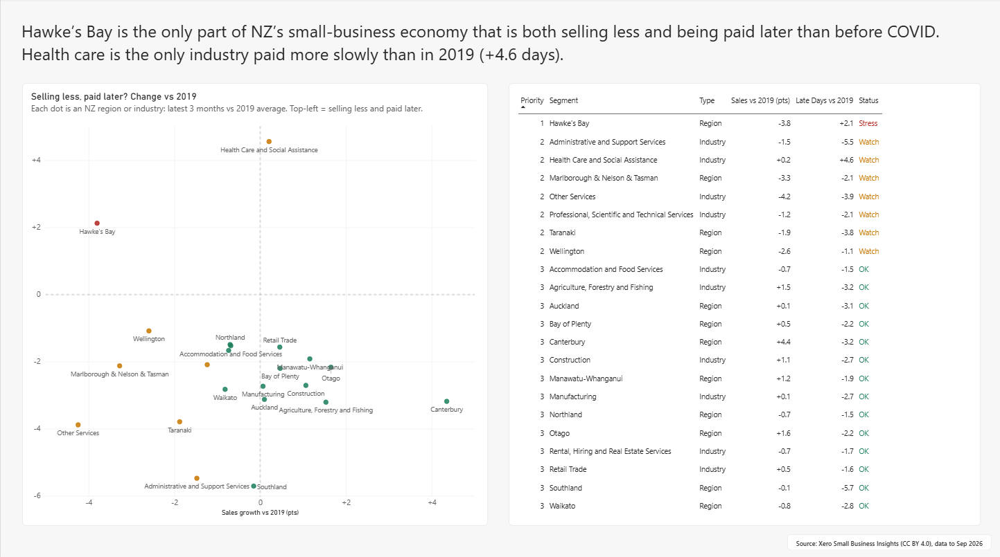
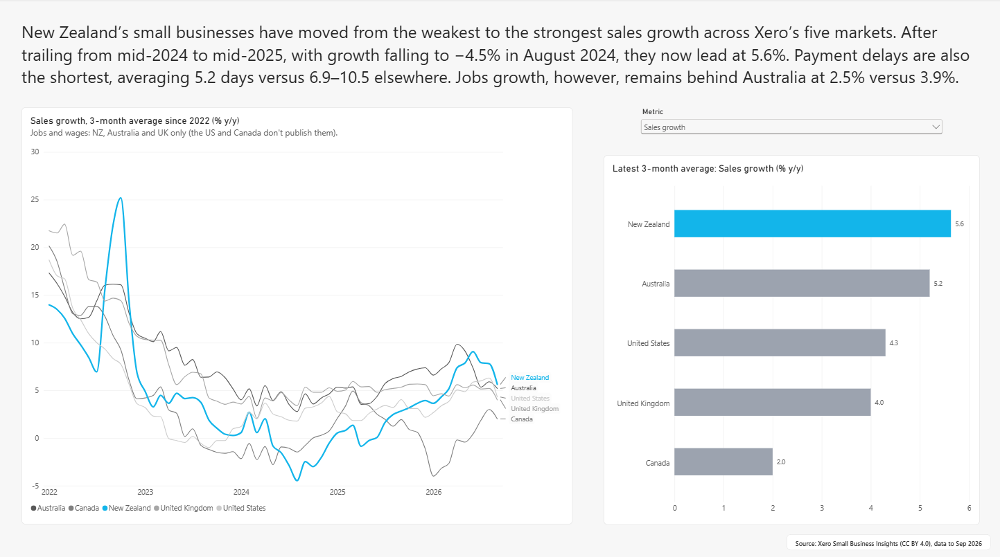

# Small Business Health: Xero Small Business Insights pipeline

A Python pipeline that turns Xero Small Business Insights (XSBI) spreadsheets into a validated star schema in SQL Server, ready for Power BI.

**The question behind it:** which New Zealand regions and industries are recovering, and where are small businesses under cash-flow stress? A comparison with Australia, the UK, the US and Canada puts NZ in context.

## Findings (September 2026 release)

"Latest" = Jul-Sep 2026 average; "vs 2019" = change against the 2019 (pre-COVID) average.

1. **Sales have recovered; pay and hiring haven't.** NZ small-business sales growth (5.6% y/y) is back at its 2019 pace, but wage growth has slowed to 1.3% (3.8% in 2019, 6.7% in mid-2022) and the net share of firms adding staff is 3.6 points, against 9.3 in 2019.
2. **From last to first internationally.** NZ had the weakest sales growth of Xero's five markets for 14 months (Jun 2024 - Jul 2025, low of -4.5% in Aug 2024). It now leads (5.6%) and has the shortest late payments (5.2 days vs 6.9-10.5 elsewhere). Jobs growth (2.5%) still trails Australia (3.9%).
3. **Wage growth is below its 2019 pace in all 12 regions.** Canterbury is recovering fastest (sales +4.4 and jobs +3.5 points vs 2019).
4. **Hawke's Bay is the only segment under cash-flow stress:** sales growth 3.8 points below 2019 and late payments 2.1 days longer, both beyond the �1 materiality threshold. Health care is the only industry paid later than in 2019 (+4.6 days).
5. **Construction has turned around** (sales growth -6.6% in Q4 2024 to +11.8% in Q2 2026). **Accommodation and food services** is the only industry where more small businesses cut payroll than added to it (net -1.5 points).

**Limits:** XSBI covers Xero's small-business subscribers, not the whole economy. Industry and region are self-reported and samples are smaller than the national series. Averages across segments are unweighted. Findings are leads for further work (e.g. checking against Stats NZ filled-jobs data), not causal conclusions.

## Report

| | |
|---|---|
|  |  |
|  |  |
|  | |

Built in Power BI Desktop on the star schema below. The `.pbix`, DAX measures and theme are in `powerbi/`.

## Data

- **Source:** [Xero Small Business Insights](https://www.xero.com/nz/resources/small-business-insights/latest-new-zealand), September 2026 release (published October 2026).
- **Coverage:** monthly, Jan 2017 - Sep 2026 nationally and Jan 2019 - Sep 2026 by industry and region, for NZ, AU, UK, US and CA. About 56,000 values.
- **Metrics:** sales, jobs and wages growth (% year-on-year), time to be paid and late payments (days, seasonally adjusted), and job creators / downsizers (% of firms). The US and Canada publish sales, time to be paid and late payments only.
- **Licence:** Data from Xero Small Business Insights, released under [CC BY 4.0](https://creativecommons.org/licenses/by/4.0/). c Xero.

## How it works

```
XSBI .xlsx files �� extract.py �� validate.py �� model.py �� load.py �� CSV + SQL Server �� Power BI
  (wide, 1 sheet       (find header,    (types, grain,    (star        (full refresh
   per metric)          reshape long)    ranges, gaps)     schema)      in one transaction)
```

1. **Extract** reads every sheet without hard-coded positions: it finds the `Month` header row, drops spacer columns, reshapes wide tables to long, and splits columns like `Job creators: AUCKLAND` into a metric and a region.
2. **Validate** checks that every value is numeric, one value per grain, values within plausible ranges by unit, no gaps in monthly series, the file name matches the latest month, and each country has the expected metrics. Errors stop the run; warnings are reported.
3. **Model** builds the star schema below with stable integer keys.
4. **Load** writes CSVs and fully refreshes SQL Server. Each XSBI release restates history (Xero revises past figures), so a full reload is the correct pattern. It runs in one transaction, so a failed load leaves the previous data in place.

### Star schema

| Table | Grain / contents |
|---|---|
| `xsbi.FactMetric` | One value per month x segment x metric (`DateKey`, `CountryKey`, `SegmentKey`, `MetricKey`, `Value`) |
| `xsbi.DimDate` | Month, quarter, year, sort columns |
| `xsbi.DimCountry` | NZ, AU, UK, US, CA |
| `xsbi.DimSegment` | `SegmentType` (National / Industry / Region) and name, per country |
| `xsbi.DimMetric` | Name, unit, and `HigherIsBetter` (late payments: lower is better) for colour coding |
| `xsbi.LoadLog` | One row per load: time, release, row count |

Views for SQL analysis: `xsbi.vMetric` (flattened) and `xsbi.vLatestVs2019` (latest 3-month average vs 2019 baseline).

## What validation found in the source data

The checks surfaced two quirks in Xero's published figures, now documented and kept as warnings:

- **Growth below -100%.** UK accommodation and food services jobs growth was about -115% (Apr 2020) and -134% (May 2020). A simple year-on-year change in a level can't go below -100%, so Xero's growth measure must be calculated differently.
- **Negative late-payment days.** 19 values are slightly below zero (as low as -2.6 days). These series are seasonally adjusted, which can push values near zero below it.

It also flags 43 growth values outside -60% to +80%, mostly COVID-era swings in small segments (for example NZ accommodation and food services sales, +301% in Apr 2021 against the 2020 lockdown).

## Setup

Requirements: Python 3.10+, SQL Server 2016 SP1 or later (Developer or Express is fine), and [Microsoft ODBC Driver 18 for SQL Server](https://learn.microsoft.com/sql/connect/odbc/download-odbc-driver-for-sql-server).

```bash
pip install -r requirements.txt
```

Download the latest release spreadsheet ZIP from the XSBI page and unzip the `*_detailed_results_YYYY_MM.xlsx` files into `data/raw/`.

## Run

```bash
python run_pipeline.py                                   # data/raw -> output/ CSVs + SQL Server (localhost, database XSBI)
python run_pipeline.py --no-sql                          # CSVs only
python run_pipeline.py --server "localhost\SQLEXPRESS"   # named instance
python run_pipeline.py --input "D:/path/to/unzipped/folder"
```

The `XSBI` database is created if it doesn't exist. Windows authentication is used by default; for a SQL login set `--user` and the `XSBI_SQL_PASSWORD` environment variable.

**Monthly refresh:** drop the new release files into `data/raw/` and rerun. Older releases in the folder are ignored automatically.

## Project structure

```
run_pipeline.py          entry point
src/extract.py           read and reshape the workbooks
src/validate.py          data quality checks
src/model.py             star schema
src/load.py              CSV and SQL Server load
sql/01_create_schema.sql tables (idempotent)
sql/02_create_views.sql  analysis views
powerbi/                 report (.pbix), DAX measures, theme, build guide
screenshots/             report pages
data/raw/                input files (not committed)
output/                  CSV output (not committed)
```

## Power BI

`powerbi/` holds the DAX measures (`measures.dax`), the report theme, and a build guide with expected values for checking the numbers. Report pages: national overview, regions, industries, cash-flow stress, international comparison.

